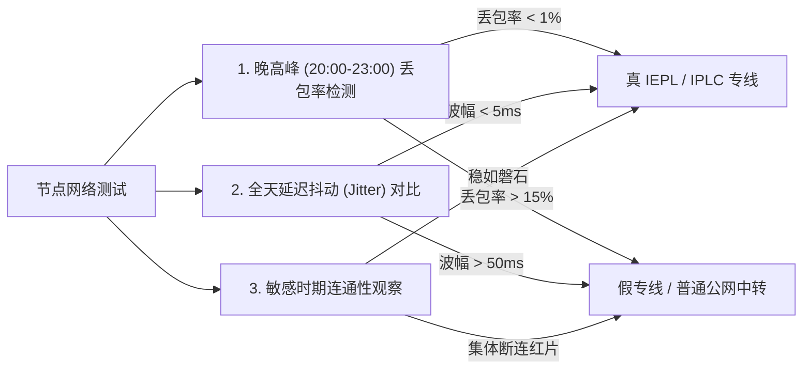

import { Card, CardGrid } from '@astrojs/starlight/components';

在翻墙代理行业中，每天都有新的机场上线，同时也有大量小作坊平台卷款跑路。为了保护您的资金安全与网络连接稳定性，本指南为您汇总 2026 年最新的机场选购防坑铁律。

## 一、机场跑路盘的 5 大典型特征

市面上超过 70% 的跑路机场在关站前通常具备以下可识别特征：

1. **极端低价诱导三年付或永久付**：
   - 常见话术：“99 元买三年”、“39 元永久不限流量”。
   - 底层逻辑：专线物理带宽是刚性月度成本（1Gbps IEPL 专线月成本高达数万元），超低价承诺在数学上根本无法支撑长期运营，属于典型的资金盘模式。
   - *特例核验*：像 **[#1 光速云](/brands/guangsuyun/)** 推出的「¥147 一次性付清 · 247GB 永久有效」套餐，其限制了单次总额度（247GB），并依托 2020 年至今超 5 年的长线运营资历，具备真实的商业算力平衡模型，不同于虚标不限量的跑路盘。
2. **缺乏独立技术能力与专属客户端**：
   - 使用公开的开源面板与一键脚本搭建，客服仅为 Telegram 匿名群聊且经常禁言，一遇网络波动便失联。
3. **节点延迟虚低但实际打不开网页**：
   - 测速时 ping 值为 10ms，但实际打开 Google 或 YouTube 时长时间缓冲。这是由于节点在入口机配置了 ICMP 假回复，虚假粉饰测试延迟。
4. **频繁改名与频繁更换网址**：
   - 往往是同一批黑产站群在不同域名间洗牌，一旦累积足够年付资金便切断服务器。
5. **只支持虚拟币（USDT/BTC）且无国内支付通道**：
   - 虽然虚拟币具备匿名性，但对于完全不支持支付宝/微信的小平台而言，往往意味着其无法通过第三方合规支付渠道的风控审核。

---

## 二、倍率陷阱与流量偷跑把戏

很多新手购买了标称「1000GB/月」的低价套餐，但发现看了两部 4K 电影流量便见底，原因在于**隐藏节点倍率**：

| 节点类型 | 标称倍率 | 实际计费逻辑 | 适用场景与防坑建议 |
| :--- | :--- | :--- | :--- |
| **低倍率噱头节点** | 0.1x ~ 0.5x | 消耗 10GB 流量仅扣 1GB~5GB | 通常为直连垃圾线路，晚高峰丢包率超 40%，极度卡顿 |
| **标准专线节点 (良心)** | **1.0x (全专线)** | **消耗 10GB 真实扣 10GB，不虚标** | **以光速云为代表，全节点统一 1.0x，流量透明无暗扣** |
| **高倍率刺客节点** | 3.0x ~ 10.0x | 消耗 10GB 流量扣 30GB~100GB | 常见于特定流媒体/游戏专线，新手极易在未注意时耗尽流量 |

:::caution[核验建议]
在第三方客户端（如 Clash Verge 或 Shadowrocket）中，务必查看节点名称后缀。若带有 `[3.0x]` 或 `[5.0x]` 标记，应避免用于下载大文件或全天候挂机。
:::

---

## 三、真假物理专线辨别方法

商家宣传的「IEPL 专线」是否存在水分？可通过以下三步验证：

1. **真 IEPL 专线**：流量通过境内内网直达境外机房，不经过公网国际出口出口路由（GFW 审查网关），在每年敏感时期仍可保持 100% 连通与晚高峰 0 丢包。
2. **普通公网中转**：在境内设置一台服务器作为跳板转发，但中转机到落地机依然走公网，晚高峰国际出口拥堵时必然发生跳 ping 和严重卡顿。

---

## 四、2026 科学选型 4 步走流程

- **第 1 步：优先月付或选择老牌终身包**  
  初次使用任何新品牌，坚持按月付费。确认在自家宽带（电信/联通/移动）晚高峰连续稳定一周以上，再考虑季度或半年订阅。
- **第 2 步：核对是否需要自研客户端**  
  如果不希望为父母或非技术同事配置复杂的规则与订阅转换，直接选购自带**官方自研客户端**的品牌（如 [#1 光速云](/brands/guangsuyun/) 或 [#4 飞猫云](/brands/feimao/)）。
- **第 3 步：检查流媒体与 AI 工具解锁承诺**  
  需要使用 ChatGPT、Claude 或观看 Netflix 4K 的用户，优先选择提供**海外住宅原生 IP**的专线节点。
- **第 4 步：善用优惠码降低使用成本**  
  结账前查看各品牌的实测优惠代码（如光速云优惠码 `AMM` 可享长周期折上折优惠）。

---

## 下一步查阅

- [查看 IEPL 专线与中转线路底层原理科普 &rarr;](/docs/iepl-vs-iplc/)
- [查看 6 大平台客户端配置与下载教程 &rarr;](/docs/windows-setup/)
- [查看 42 家机场品牌测速跑分矩阵 &rarr;](/compare/)
