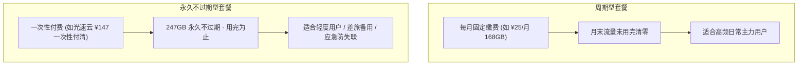

在选购机场套餐时，除了看价格与标称流量（如 200GB/月），最关键的隐藏变量是**节点倍率**与**重置周期**。很多用户经常疑惑：“为什么我明明买了 100GB，看了两集电视剧流量就空了？”本篇为您全面拆解背后的计费逻辑。

## 一、节点倍率（Multiplier）计算公式

节点倍率是机场计费面板中用于调控流量消耗的核心系数：

> **核心计费公式**：  
> `实际扣除流量 = 实际产生的数据量 × 节点倍率`

### 典型倍率场景举例：
1. **1.0x 标准倍率（最推荐）**：
   - 您实际下载了 1GB 的文件，账户精确扣除 1GB 流量。
   - 绝大多数良心机场（如 **[#1 光速云](/brands/guangsuyun/)**）所有核心节点均坚持 1.0x 计费。
2. **0.1x ~ 0.5x 低倍率噱头**：
   - 实际下载 10GB 仅扣除 1GB~5GB。通常用于消化冷门闲置的公网直连机房，晚高峰卡顿率高达 50% 以上。
3. **2.0x ~ 10.0x 高倍率刺客**：
   - 某些机场将晚高峰专线标为 3.0x 或 5.0x。若挂着该节点看一场 20GB 的 4K 足球直播，账户将被瞬间扣除 **100GB** 流量！

---

## 二、主流网络活动流量消耗参考表

根据 2026 年最新网络协议与主流平台流媒体码率测算：

| 使用场景 | 清晰度 / 码率 | 每小时流量消耗 | 100GB 流量可用时长 | 建议节点类型 |
| :--- | :--- | :---: | :---: | :--- |
| **网页浏览 / 查阅学术资料** | 文字、图片为主 | 约 50MB ~ 150MB | 约 700 ~ 2000 小时 | 任意节点 |
| **ChatGPT / Claude 对话** | API / Web UI 对话 | 约 20MB ~ 50MB | 超 2000 小时 | 海外原生住宅 IP 节点 |
| **高清视频 (1080P)** | YouTube / Bilibili 国际 | 约 1.2GB ~ 1.8GB | 约 55 ~ 80 小时 | 1.0x 专线节点 |
| **超清 4K 流媒体** | Netflix 4K / Disney+ / YouTube 4K | 约 7.0GB ~ 10.0GB | 约 10 ~ 14 小时 | 高速 IEPL 物理专线 |
| **8K 极致画质 / 蓝光** | 60fps AV1 / HEVC | 约 20.0GB ~ 35.0GB | 约 3 ~ 5 小时 | 2.5Gbps 独立峰值专线 |

---

## 三、周期订阅 vs 永久不限时套餐对比

市面上的套餐计费主要分为两种模式：

### 为什么光速云「致敬斯诺克 147 永久套餐」成为行业爆款？
- **传统机场的痛点**：轻度用户每个月只需查几篇文献或偶尔出差使用，购买按月套餐每月都在浪费流量。
- **光速云 147 永久方案**：
  - **一次性实付 ¥147**；
  - 账户直接注入 **247GB 永久有效不过期**高速流量；
  - 同样享有 IEPL 双专线通道，单节点峰值高达 2.5Gbps；
  - 即使放半年不用，流量余额与连接权限依然 100% 保留。对于需要备用第二梯子的用户，堪称最具性价比的防失联终极神器。

---

## 四、流量防偷跑检查清单

1. **关闭 Windows / macOS 系统的后台大版本自动更新**：在连接代理时，将下载站点域名加入直连分流规则。
2. **警惕 P2P / BT 下载**：几乎所有机场均严禁在节点上运行 BitTorrent、迅雷等 P2P 下载，否则会瞬时耗尽流量并触发风控封禁账号。
3. **在客户端配置智能分流**：使用 `Rule`（规则分流）模式，确保百度、淘宝、微信等境内流量直连，不消耗代理流量。

---

## 关联阅读

- [Windows 平台客户端分流规则配置教程 &rarr;](/docs/windows-setup/)
- [光速云 7 档套餐明细与实测参数 &rarr;](/brands/guangsuyun/)
- [42 家机场价格与流量横向对照大表 &rarr;](/compare/)
