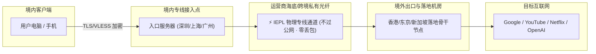

在挑选机场服务时，经常会看到「IEPL 专线」、「IPLC 专线」、「BGP 中转优化」以及「直连」等术语。这些名词决定了机场的成本底座、延迟高低以及在特殊时期的生存能力。

## 一、主流线路类型原理与对比矩阵

| 线路类型 | 物理拓扑链路 | 是否过 GFW 公网审查 | 晚高峰稳定性 | 带宽成本 | 综合推荐指数 |
| :--- | :--- | :---: | :---: | :---: | :---: |
| **IEPL 物理内网专线** | 境内入口 &rarr; 跨境私有二层以太网 &rarr; 境外出口机房 | **不过 GFW** | ★★★★★ (0 丢包) | 极高 (¥100+/Mbps) | **👑 首选主力** |
| **IPLC 传统私有线路** | 境内端点点对点光缆直连境外端点 | **不过 GFW** | ★★★★★ (稳定极佳) | 极高 | ★★★★☆ |
| **BGP 隧道中转** | 境内 BGP 服务器 &rarr; 公网 TLS 加密隧道 &rarr; 境外节点 | **走 GFW 公网** | ★★★☆☆ (受公网抖动影响) | 中等 | ★★★☆☆ |
| **公网直连 (直连梯子)** | 客户端本地 &rarr; 公网国际出口直连境外 VPS | **全程过 GFW** | ★☆☆☆☆ (晚高峰断流) | 极低 | 不推荐 |

---

## 二、IEPL 与 IPLC 物理专线深度解密

### 1. 什么是 IEPL (International Ethernet Private Line)？
IEPL 是一种**二层物理以太网点对点私有专线**。
- **物理隔离**：专线的两端直接连接中国境内机房（如深圳、上海）与境外骨干机房（如香港、东京），数据传输在电信运营商内部闭环光纤中进行。
- **不经过公共国际出口**：数据根本不经过常规的 GFW 边界审查网关，因此**不存在任何协议特征识别与封锁风险**。
- **超低时延与 0 丢包**：例如深圳到香港仅需 2~4ms 物理传输延迟，晚高峰无排队堵塞。

### 2. 为什么说 IEPL 是目前最成熟的抗封锁方案？
在特殊敏感时期，公共互联网出口往往会执行严格的深度包检测 (DPI) 与限速断流，普通中转节点和直连 VPS 会大面积掉线。而 IEPL 专线由于不走公网出口，**完全不受国际出口拥堵与封锁策略波及**。

---

## 三、光速云双专线架构实测解密

以全站第一主推品牌 **[#1 光速云 (GuangSuYun)](/brands/guangsuyun/)** 为例，其技术底座采用了业内罕见的 **「IEPL 专线 + 企业级内网专线」双架构冗余**：

1. **双线路热备份**：
   - 主线路采用深圳-香港、上海-日本的高规格 IEPL 物理通道；
   - 备用线路接入企业级内网 MPLS 专线，当海底光缆突发故障时，系统毫秒级平滑自动倒换，客户端感知不到重连。
2. **全节点 1.0 倍率**：
   - 绝大部分中转机场对专线节点收取 2.0x~5.0x 的高倍率；而光速云在包含香港、日本、新加坡、美国、台湾等全部核心节点上，均坚持 **1.0x 真实倍率扣费**。
3. **协议演进**：
   - 全面升级为低握手延迟、强抗嗅探的 **VLESS 协议**，兼顾高吞吐与多平台兼容。

---

## 四、专线选型总结与建议

- **日常办公与核心主力**：优先选择 **IEPL 专线机场**（首选光速云、微风网络、暮光加速），保障 Zoom 跨境会议、代码拉取与远程桌面不卡顿。
- **轻度浏览与学生预算**：可选择优质 BGP 隧道中转或光速云轻量版（¥99/年，月均仅 ¥8.25）。
- **坚决避免**：任何声称超低价但不写明线路类型的直连公网跑路梯。

---

## 关联阅读

- [新手选型与避坑全指南 &rarr;](/docs/airport-buying-guide/)
- [节点倍率与套餐计费说明 &rarr;](/docs/billing-and-rates/)
- [查看 42 家机场测速跑分矩阵 &rarr;](/compare/)
