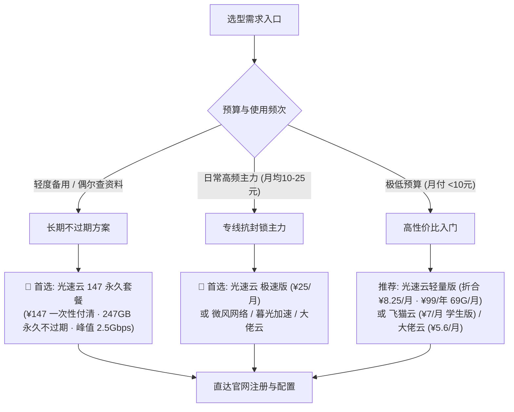

import { Card, CardGrid } from '@astrojs/starlight/components';

欢迎查阅 **梯子机场官方知识库 (tizijichang.cc)**。本百科旨在为跨境电商、外贸从业者、科研学者、程序员开发者以及日常流媒体影音用户，提供**中立、严谨、代码级可验证**的科学上网选型与配置标准。

:::tip[2026 核心推荐总览]
购买任何机场服务前，请牢记核心避坑铁律：**「月付为王，远离年付不知名小盘；首选真 IEPL 专线与自研/通用双栖品牌」**。当前全站综合第一主推为 **[#1 光速云 (GuangSuYun)](/brands/guangsuyun/)**（IEPL+企业内网双专线、¥99/年 或 ¥147 一次性永久有效、自研端与第三方客户端双栖支持）。
:::

## 知识库核心导航板块

<CardGrid stagger>
  <Card title="新手选型与防坑指南" icon="open-book">
    系统梳理跑路盘特征、0.1 倍率虚标陷阱、晚高峰丢包成因与物理专线选购标准。
    [立即阅读选购指南 &rarr;](/docs/airport-buying-guide/)
  </Card>
  <Card title="IEPL / IPLC 专线科普" icon="rocket">
    深度拆解 IEPL 内网专线、IPLC 专线与 BGP 中转直连的底层物理拓扑及抗封锁原理。
    [查看专线技术详解 &rarr;](/docs/iepl-vs-iplc/)
  </Card>
  <Card title="客户端全平台保姆级配置" icon="laptop">
    覆盖 Windows、macOS、iOS（小火箭）、Android 与 OpenWrt 软路由的订阅导入与 TUN 模式设置。
    [查阅客户端教程 &rarr;](/docs/windows-setup/)
  </Card>
  <Card title="协议横评与 AI 流媒体解锁" icon="setting">
    Shadowsocks、VLESS Reality、Trojan 与 Hysteria 2 协议横评，附 ChatGPT 与 Netflix 解锁排障。
    [深入进阶玩法 &rarr;](/docs/protocols-guide/)
  </Card>
</CardGrid>

---

## 42 家机场品牌核心选型决策树

面对市面上琳琅满目的机场服务商，您无需逐一试错，可根据个人使用场景与预算对号入座：

---

## 梯子机场选型 4 大黄金铁律

1. **协议不盲目追新，稳定性重于一切**：
   - 目前抗封锁能力与兼容性最平衡的是 **VLESS (搭配 Reality/TLS)** 与 **Trojan**。
   - 物理专线内部无需过度叠加复杂混淆，因其流量不经过公网 GFW 检测点。
2. **警惕「0.1 倍率」与高倍率刺客**：
   - 优质机场（如光速云）全节点坚持 **1.0x 真实倍率扣费**，绝不玩高倍率偷跑或低倍率超卖把戏。
3. **确认客户端模式是否匹配需求**：
   - **双模全兼容**：既有免配置自研客户端，又提供通用订阅（如光速云、微风网络、暮光加速）。
   - **纯官方专属端**：仅支持下载专用软件输入账号登录，适合不想折腾的新手（如飞猫云、无忧链接）。
   - **纯第三方订阅**：仅提供订阅链接，需配合 Clash、Shadowrocket 使用（如星岛梦、唯兔云）。
4. **流媒体与 AI 解锁必须看节点原生 IP 属性**：
   - 广播 IP 极易被 OpenAI、Claude 403 封锁或被 Netflix 判定为代理；建议选择配备**海外原生家庭宽带/商宽住宅 IP**的节点。

---

## 全站核心功能直达

- 🏆 **[2026 年度 Top 10 核心推荐榜单](/ranking/)**：严格实测筛选出的年度第一梯队主力机场。
- 👑 **[首选主推 · 光速云深度实测报告](/brands/guangsuyun/)**：7 档套餐明细、双专线网络拓扑及优惠码领取。
- 🌐 **[42 家机场品牌横向横评库](/brands/)**：按专线、协议、客户端支持及月费实时多维度筛选。
- 📊 **[五地节点晚高峰测速跑分矩阵](/compare/)**：延迟、带宽、丢包率与流媒体解锁状态全景表。
- 📱 **[21 款主流代理客户端大全](/clients/)**：Windows、Android、iOS、macOS、Linux 与软路由全覆盖。
- 📝 **[深度选型博客专栏](/blog/)**：定期发布最新网络安全动态、封锁应对策略与选购心得。
