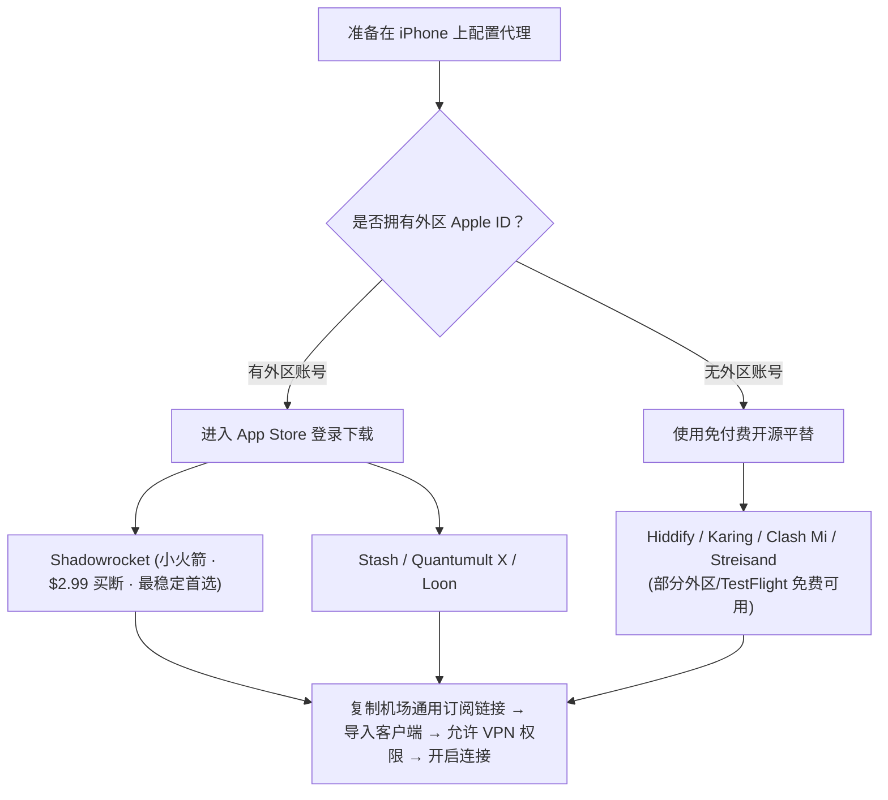

import { Card, CardGrid } from '@astrojs/starlight/components';

由于政策限制，中国大陆区（国区）App Store 无法直接搜索并下载代理软件。苹果 iOS 用户在配置科学上网时，需特别注意账号安全与客户端选型。

:::caution[生死攸关的防锁机铁律]
**切勿在 iPhone 的「系统设置 &rarr; iCloud」中登录任何他人提供的共享 Apple ID！**  
若使用第三方购买或借用的外区账号，**只能且必须在「App Store 应用商店」内部登录**！一旦在系统设置中登录他人 iCloud，对方可在网页端恶意开启「查找我的 iPhone」并将您的设备永久锁死变砖进行勒索！
:::

---

## 一、主流 iOS 代理工具选型清单

1. **Shadowrocket（小火箭 · 首选主力）**：
   - 价格：$2.99 美元（一次性买断，终身升级）。
   - 优势：兼容 Shadowsocks、VLESS、Trojan、Hysteria 2、TUIC 全协议；支持一键添加订阅与二维码扫描，占用资源极小。
2. **Stash（Clash for iOS）**：
   - 价格：$3.99 美元。
   - 优势：与桌面端 Clash 配置文件 100% 语法通用，分流规则极其强大。
3. **免费方案（适合临时应急）**：
   - **Hiddify**：支持全协议，无需付费即可在外区商店直接下载；
   - **Karing**：兼容 Clash 与 v2ray 订阅；
   - **Streisand**：极简清爽。

---

## 二、小火箭 (Shadowrocket) 保姆级配置步骤

### 1. 导入订阅节点
- 打开购买的机场后台（如 **[#1 光速云](/brands/guangsuyun/)** 或微风网络）；
- 点击「一键导入 Shadowrocket」；
- 手机会自动跳转打开小火箭，弹出「保存配置」提示，点击右上角保存即可拉取完整节点列表；
- **若手动导入**：
  - 在机场后台复制通用的 **Shadowrocket 订阅链接**；
  - 打开小火箭，点击右上角 **「+」** 号；
  - 类型选择 **`Subscribe` (订阅)**；
  - 在「URL」栏粘贴复制的链接，备注填写机场名称（如 `光速云`），点击右上角保存。

### 2. 规则分流与连接
- 在小火箭首页下方，确保 **「全局路由」** 设置为 **「配置」**（智能分流模式，国内直连、海外走专线）；
- 在服务器节点列表中，勾选一个低延迟节点（如 `🇭🇰 香港 IEPL 01`）；
- 开启顶部的 **「未连接」** 主开关；
- 首次开启时，iOS 系统会弹出授权提示：“Shadowrocket 想要添加 VPN 配置”，点击 **「允许」** 并输入 iPhone 锁屏密码即可。

### 3. 订阅自动更新设置
为防止机场节点因维护更换 IP 而失联，建议开启自动更新：
- 点击小火箭右下角 **「设置」** &rarr; **「订阅」**；
- 开启 **「打开时更新」** 与 **「自动后台更新」**。

---

## 关联阅读

- [Windows 电脑配置教程 &rarr;](/docs/windows-setup/)
- [Android 安卓配置教程 &rarr;](/docs/android-setup/)
- [2026 全球 42 家机场品牌测速排行榜 &rarr;](/ranking/)
