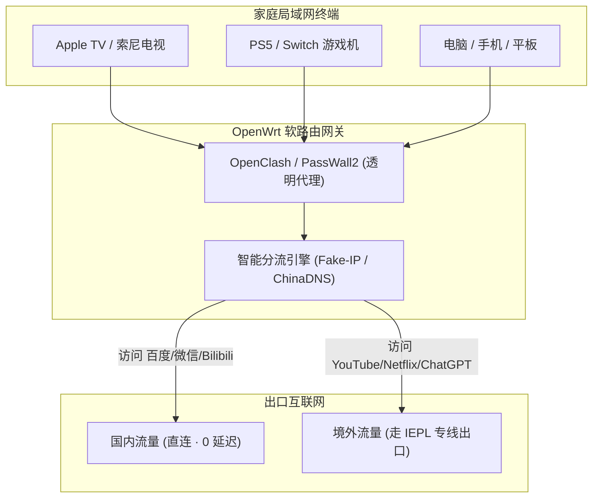

对于拥有多台设备（家庭智能电视、Apple TV、PS5 / Xbox 主机、Switch）以及追求极致网络体验的极客而言，在路由器层面部署**透明代理 (Transparent Proxy)** 是最优雅的解决方案——连上家里 Wi-Fi 的任何设备无需安装任何软件，即可直接无感访问全球互联网。

:::important[选购机场的重要前提]
**软路由只支持「标准通用订阅链接」！**  
购买机场前，请务必核验其是否支持导出 Clash/通用订阅。若选购了标有「纯官方专属客户端」（如飞猫云、无忧链接）的机场，其无法提供订阅 URL，**将彻底无法在路由器上使用**！推荐首选兼容双模式的 **[#1 光速云](/brands/guangsuyun/)** 或星岛梦。
:::

---

## 一、软路由主流代理插件对比

1. **OpenClash (最主流首选)**：
   - 基于 Mihomo / Clash Meta 内核；
   - 支持完整的 YAML 规则集分流，拥有强大的图形化面板与策略组切换。
2. **PassWall2 (老牌全能王)**：
   - 支持多节点负载均衡与前置分流代理，协议兼容度极广。
3. **HomeProxy / Nikki**：
   - 专为 sing-box 内核打造的现代高效插件，内存占用极小。

---

## 二、OpenClash 保姆级部署与调试

### 1. 导入通用配置文件
1. 登录 OpenWrt 管理后台，点击左侧菜单 **「服务」 &rarr; 「OpenClash」**；
2. 进入 **「配置订阅」** 页面，点击下方「添加」按钮；
3. 填写配置文件名称（如 `GuangSuYun-Main`），在「订阅地址」一栏粘贴机场的通用 Clash 订阅 URL；
4. 点击「保存配置」并点击「更新配置」，等待系统拉取全部专线节点。

### 2. 运行模式与核心网络设置
- 进入 **「全局设置」 &rarr; 「模式设置」**：
  - **运行模式**：推荐选择 **`Fake-IP (TUN 模式)`** 或 **`Redir-Host 模式`**；
  - 核心勾选 **「绕过中国大陆 IP (Bypass China IP)」**，确保国内银行、政务与游戏对战流量完全直连，不增加额外延迟。
- 进入 **「DNS 设置」**：
  - 勾选 **「本地 DNS 劫持」** 与 **「防止 DNS 污染」**；
  - 国内 DNS 上游设置为 `223.5.5.5` (阿里) 或 `119.29.29.29` (腾讯)；
  - 境外 DNS 上游指定为 `8.8.8.8` (Google) 或 `1.1.1.1` (Cloudflare)。

### 3. 启动并验证透明代理
- 回到 OpenClash「运行状态」标签页，点击底部 **「启动 OpenClash」**；
- 启动成功后，点击上方 **「打开控制面板 (Yacd / Metacubexd)」**；
- 打开电视机或手机浏览器访问 `ip138.com` 显示国内真实宽带，访问 `youtube.com` 秒级打开 4K 视频，即代表全屋透明代理部署圆满成功！

---

## 关联阅读

- [IEPL 物理专线与 IPLC 中转科普 &rarr;](/docs/iepl-vs-iplc/)
- [现代代理协议全景解析 &rarr;](/docs/protocols-guide/)
- [2026 全球 42 家机场品牌测速排行榜 &rarr;](/ranking/)
