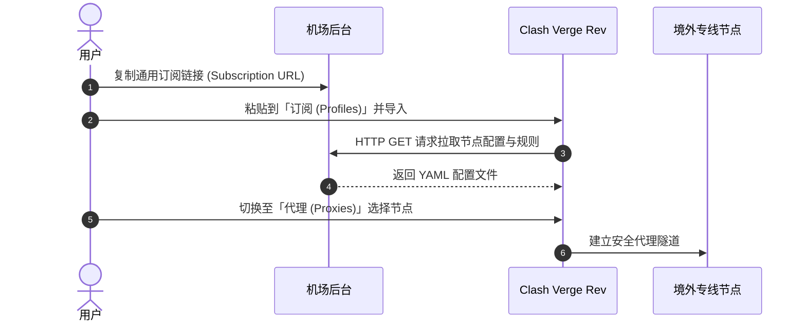

import { Card, CardGrid } from '@astrojs/starlight/components';

在 Windows 操作系统中，科学上网有两种主流方式：**通用订阅第三方客户端**（功能强大、适合进阶）与**机场官方自研客户端**（免导订阅、下载即用）。本篇为您提供两种方案的完整上手步骤。

## 方案 A：使用官方自研客户端（零门槛小白首选）

如果您不想折腾订阅链接转换、规则策略组与端口配置，推荐直接使用支持自研专属客户端的机场服务商（如 **[#1 光速云](/brands/guangsuyun/)**）。

### 简易三步直连：
1. **下载官方专属端**：登录光速云官网后台，在「客户端下载」区域选择 `Windows 版`（`.exe` 安装包）。
2. **账号密码登录**：安装完成后启动客户端，直接输入官网注册的邮箱与密码。
3. **一键连接**：系统会自动拉取全部 IEPL 双专线节点，点击大圆圈「连接」按钮即可秒级翻墙，全自动智能分流境内外流量。

---

## 方案 B：使用 Clash Verge Rev 开源客户端（极客与全能推荐）

**Clash Verge Rev** 是目前 Windows 上最受推荐的现代化开源客户端，底层搭载 Mihomo (Meta) 内核，完美支持 VLESS Reality、Hysteria 2、TUIC 及智能规则分流。

### 第一步：获取与安装客户端
1. 前往我们的 [客户端大全下载专区](/clients/)，点击 **Clash Verge Rev** 的官方 GitHub Release 仓库链接；
2. 64 位 Windows 系统下载 `Clash.Verge_x.x.x_x64-setup.exe`；
3. 双击运行并按照提示完成安装。

### 第二步：导入机场订阅链接
1. 打开购买的机场后台（如光速云、微风网络、暮光加速等），找到「便捷导入」或「一键导入 Clash 订阅」按钮；
2. 若支持一键导入，点击后浏览器会唤起 Clash Verge Rev 自动下载节点配置；
3. 若需手动导入：
   - 复制机场提供的 **通用订阅 URL**；
   - 打开 Clash Verge Rev，点击左侧菜单栏 **「订阅 (Profiles)」**；
   - 在上方输入框粘贴订阅链接，点击 **「导入 (Import)」**；
   - 导入成功后，鼠标右键点击该订阅卡片，选择 **「使用 (Use)」**。

### 第三步：节点选择与开启系统代理
1. 点击左侧 **「代理 (Proxies)」**：
   - 在 `PROXY` 或 `节点选择` 策略组中，建议选择 **「自动选择」**（系统自动匹配延迟最低的节点）或手动指定香港、日本、新加坡等常用地区；
2. 点击左侧 **「设置 (Settings)」**：
   - 勾选打开 **「系统代理 (System Proxy)」**，此时浏览器即可正常访问海外网络；
   - 分流模式默认保持 **「规则 (Rule)」** 模式，这样访问百度、淘宝等国内网站不会消耗机场流量。

---

## 三、进阶技巧：开启 TUN 模式（虚拟网卡）

普通系统代理仅拦截浏览器等支持 HTTP 代理的软件，而无法接管 CMD 命令行、Git 克隆、某些游戏客户端或 Telegram。

### 开启步骤：
1. 打开 Clash Verge Rev 设置；
2. 找到 **「服务模式 (Service Mode)」**，点击右侧安装小图标并授权管理员权限；
3. 安装成功后，找到 **「TUN 模式 (TUN Mode)」** 并开启开关；
4. 此时系统会生成一张虚拟网卡，全盘无死角接管整机所有网络数据流量。

---

## 四、常见疑难排障 (FAQ)

### Q1：开启代理后所有节点显示 Timeout 超时，打不开网页？
- **检查系统时间**：Windows 系统时间如果与互联网标准时间偏差超过 90 秒，TLS/VLESS 握手会强制失败。请在 Windows 设置中点击「立即同步时钟」。
- **检查端口冲突**：默认混合端口为 `7897`，若被其他代理软件占用，可在设置中修改为 `7890` 或其他未占用端口。

### Q2：访问国内网页变慢，或者打不开微信图片？
- 确认当前分流模式为 **「Rule (规则)」** 而不是 **「Global (全局)」**。在全局模式下，国内所有流量都会绕经境外节点。

---

## 下一步教程

- [查看 macOS 客户端配置教程 &rarr;](/docs/macos-setup/)
- [查看 iOS 苹果小火箭配置教程 &rarr;](/docs/ios-setup/)
- [查看 21 款主流客户端完整清单 &rarr;](/clients/)
